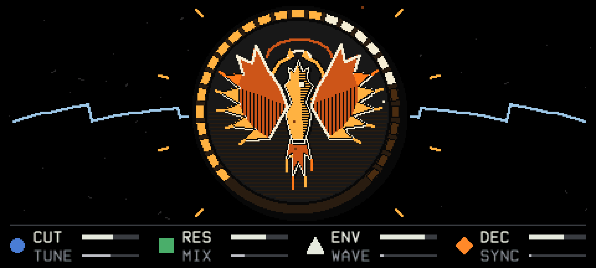

# Lilith

A two-oscillator synth with a Moog-style ladder low-pass and a cutoff envelope: fat basses, squelchy acid and brassy leads. Her faceplate is a phoenix in a medallion that comes alive as you play: wings beat on every note and settle with the envelope, feathers catch fire with the filter, a siren ring sweeps with the cutoff and her song scrolls across the screen.

Lilith lives on more than one instrument. Each has its own folder:

| Instrument | Folder | State |
| --- | --- | --- |
| **OP-1 Field** | [`field/`](field/) | `lilith.pack` for OS 1.7.3+0 with open-field: an engine of her own in the engine list, with ten presets. Read the warning there first |
| OP-XY | | Lilith started as an OP-XY machine (Open-XY); to come here |

## Hear her

Short phrases rendered on a Mac through the pack's own sound code (the unit's own envelope is approximated here, and the unit adds its mixer and effects):

| Preset | | Preset | |
| --- | --- | --- | --- |
| bass | [listen](demos/lilith-bass.m4a) | acid | [listen](demos/lilith-acid.m4a) |
| funk bass | [listen](demos/lilith-funk-bass.m4a) | squelch | [listen](demos/lilith-squelch.m4a) |
| seq bass | [listen](demos/lilith-seq-bass.m4a) | taurus | [listen](demos/lilith-taurus.m4a) |
| brass | [listen](demos/lilith-brass.m4a) | sync | [listen](demos/lilith-sync.m4a) |
| glide lead | [listen](demos/lilith-glide-lead.m4a) | prog lead | [listen](demos/lilith-prog-lead.m4a) |

## Licence

MIT ([LICENSE](LICENSE)). Lilith's sound engine comes from the OP-XY Lilith (Open-XY contributors, MIT).
