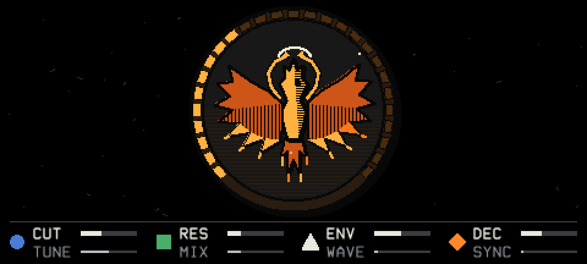
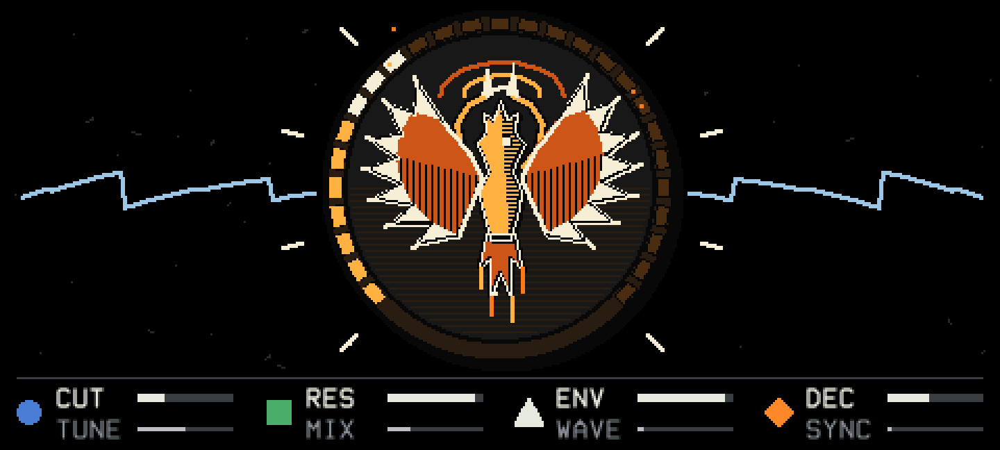

# Lilith for the OP-1 Field (lilith.pack)

> **Read this first**
>
> - This pack is for **OP-1 Field OS 1.7.3+0** running [open-field](https://github.com/LaP0573/open-field) with `base.pack` and **`engines.pack`**, which hosts engines of packs' own.
> - Installing open-field changes your unit's firmware, at your own risk. Read open-field's NOTICE first.
> - **Never install 1.7.3+1.** It locks the bootloader (1000.2.0). Only 1.7.3+0 on bootloader 1000.1.1 works.
> - A pack is a program that can read and write the files on your unit: take packs only from people you trust.

## What she is

Lilith is a synth engine of her own, picked in the engine list next to the stock engines. Two oscillators (the second tunable from an octave down to an octave up, mixable, with a wave from saw to square and hard sync) through a four-pole ladder low-pass with resonance and a decay envelope on the cutoff. She is polyphonic, one Lilith for each of the unit's six voices, and the unit's own envelope, mixer, effects and LFO work on her as on any engine.

| Idle | An acid note |
| --- | --- |
|  |  |

## Install

1. Put the unit in disk mode and copy `lilith.pack` into the `packs` folder, next to `base.pack` and `engines.pack`.
2. Restart the unit **twice**. The first start writes her ten presets into `user/synth_presets/lilith/`; the unit lists them from the next start.
3. Pick **lilith** in the engine list, or one of her presets.

Uninstall: delete `lilith.pack` from `packs`. Her presets stay in `user/synth_presets/lilith/` until you delete them; a patch that names her loads as a stock engine without the pack. If anything goes wrong, hold the help key while you switch the unit on: it starts with no packs.

## Controls

The encoders are named by position: the 1st is the leftmost, the 4th the rightmost.

| Encoder | Turn | With shift |
| --- | --- | --- |
| 1st | CUTOFF | TUNE: the second oscillator, an octave down to an octave up, unison in the middle |
| 2nd | RESONANCE | MIX: the first oscillator, both, or the second |
| 3rd | ENVELOPE: how far each note opens the filter | WAVE: saw to square |
| 4th | DECAY of that envelope | SYNC: the second oscillator restarts with the first |

Her faceplate follows the knobs: the ring around the medallion is the cutoff and the envelope, the feathers light up with the envelope amount, siren arcs come from her beak with resonance, embers fall under her tail with decay, and a strip along the bottom shows all eight values.

## Presets

acid, bass, brass, funk bass, glide lead, prog lead, seq bass, squelch, sync, taurus.
